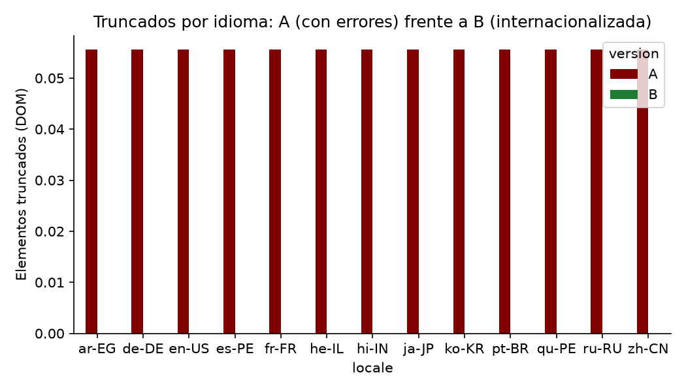

# Internacionalización: medición de calidad

Evidencia para el Lab 13 (L.4, pasos 2 y 3) y la Spec W13 (G.5.5): **truncados y desbordes antes y después** de internacionalizar.

## Qué se mide

La función `medir()` de [`js/lib/i18n-calidad.js`](../../js/lib/i18n-calidad.js) reproduce el «Auditar DOM» del ejercicio 13.2 del profesor. Las 12 primeras columnas del CSV son las suyas, así que su notebook (`ejercicio_13_3_analisis_internacionalizacion.ipynb`) lee nuestros archivos sin cambios.

| Columna | Qué es |
|---|---|
| `truncados` | Elementos visibles que **recortan texto**: `overflow` hidden o clip, o `text-overflow: ellipsis`, con `scrollWidth > clientWidth + 1` |
| `desbordes` | Elementos que salen del ancho visible de la página |
| `fechas_fijas` · `dinero_fijo` | Fechas `dd/mm/aaaa` y montos `$123.45` escritos con un formato fijo en el texto visible |
| `lang_ok` · `dir_ok` | Si `<html lang>` coincide con el idioma medido y si la dirección calculada es la que corresponde (rtl en árabe y hebreo) |
| `expansion` | Caracteres visibles frente a es-PE, en %, en la misma versión, página, ancho y pseudolocalización |
| `pagina`, `ancho`, `desplazables`, `scroll_horizontal` | Columnas nuestras: la página, el ancho de la ventana, las regiones con desplazamiento propio (tablas anchas) y si la página entera se desplaza en horizontal |

**Diferencias declaradas con la versión del profesor:**
- `truncados` no cuenta las regiones con `overflow: auto` (una tabla ancha que se desplaza no recorta texto); esas van en `desplazables`.
- `desbordes` no cuenta lo que está dentro de un contenedor que recorta o desplaza, ni lo oculto a propósito: el enlace «Saltar al contenido» y el texto solo para lectores de pantalla (`.sr`).

## Versiones A y B

- **A (antes):** el sitio en la etiqueta git [`i18n-antes`](https://github.com/JosMart04/EquipoA_ErnestoInvestingAI/releases/tag/i18n-antes), antes de los cambios de este laboratorio.
  - Esa versión solo carga `i18n/es-PE.json`, así que la herramienta le entrega el diccionario del idioma medido en su lugar.
  - El `<html>` queda en `lang="es-PE"` y sin `dir`, como en la versión A del ejercicio 13.2.
- **B (después):** el sitio actual, con `?lang=<locale>`.
- **Pseudolocalización:** el algoritmo del kit del profesor (tildes y unos 40 % más de texto, entre corchetes). Se aplica igual en las dos versiones, transformando el diccionario que pide la página.

## Cómo se ejecuta

Requiere las dependencias de `tests/` (`npm ci --prefix tests --ignore-scripts`) y Microsoft Edge. Con `MEDIR_CANAL=chromium` usa el Chromium de Playwright.

```powershell
git worktree add ..\eia-i18n-antes i18n-antes
$L = "es-PE,en-US,ar-EG,he-IL,ja-JP,zh-CN,ko-KR,hi-IN,ru-RU,pt-BR,fr-FR,de-DE,qu-PE"
node tools/i18n/medir_i18n.mjs --version A --raiz ..\eia-i18n-antes --dicc locales --locales $L --salida docs/i18n/ejercicio_13_2_auditoria_investing_ai_PRUEBA_TECNICA_BOT.csv
node tools/i18n/medir_i18n.mjs --version B --locales $L --anexar --salida docs/i18n/ejercicio_13_2_auditoria_investing_ai_PRUEBA_TECNICA_BOT.csv
```

`--dicc locales` le entrega a la versión A los diccionarios actuales de los 13 idiomas. La versión A no los tenía: así se mide cómo se habría visto la interfaz antigua con esos textos.

Cada combinación (página × idioma × pseudolocalización × ancho) usa un contexto limpio de Chromium con `locale es-PE`, la zona `America/Lima` y movimiento reducido.

> **PRUEBA_TECNICA_BOT:** estas filas las genera un robot para medir la interfaz. **No son datos de personas** (Spec W13, G.10.2).

## Resultados

Archivo completo: [`ejercicio_13_2_auditoria_investing_ai_PRUEBA_TECNICA_BOT.csv`](ejercicio_13_2_auditoria_investing_ai_PRUEBA_TECNICA_BOT.csv). Son 936 mediciones: 9 páginas × 13 idiomas × pseudolocalización sí y no × 375 y 1280 px, en cada versión.

| Versión | Mediciones | Truncados | Desbordes | Con scroll horizontal | `lang` incorrecto | `dir` incorrecto |
|---|---|---|---|---|---|---|
| **A (antes)** | 468 | 26 | 45 | 45 | 432 | 72 |
| **B (después)** | 468 | **0** | **0** | **0** | **0** | **0** |

**En A:**
- **Truncados:** el tramo angosto de la barra apilada de Backtesting a 375 px.
- **Desbordes:** el aviso del pie con pseudolocalización a 375 px, en las 9 páginas, en es, ru, pt, fr y de.
- **`lang`:** se queda en es-PE en los 12 idiomas que no son el español.
- **`dir`:** falta `dir="rtl"` en árabe y hebreo.

En B, todo eso está corregido.

**`dinero_fijo` > 0 en B** (en-US, ja-JP, hi-IN, zh-CN y ko-KR) es un falso positivo de la heurística `\$\d+\.\d{2}`. Son montos que formatea `Intl` en USD («$123.45», «US$123.45»), no texto escrito a mano. En A sale 0 porque la versión antigua formateaba todo como es-PE («US$ 123.45»).

**Figura del notebook del profesor** (`ejercicio_13_3_analisis_internacionalizacion.py`, ejecutado sin cambios con nuestro CSV; salida en [`notebook_13_3_salida_PRUEBA_TECNICA_BOT.txt`](notebook_13_3_salida_PRUEBA_TECNICA_BOT.txt)):



Hay **capturas antes y después** en [`docs/capturas/i18n/`](../capturas/i18n/):
- Inicio y Clasificación en es-PE, ar-EG, ja-JP y de-DE a 1280 px;
- Inicio y Backtesting en móvil (375 px) con pseudolocalización.

## Iteración 2: las 16 páginas (23-nov-2026)

La interfaz nueva (D-26) agregó siete páginas a la barra lateral: Detalle de activo, Comparador, Historial de órdenes, Perfil, Configuración, Ayuda y Acerca de. Además sumó un shell con barra lateral, cinta y notificaciones. Por eso se repitió la medición de la versión B sobre **todas las páginas de `PAGINAS_NAV`**, que ahora es la lista por defecto de `medir_i18n.mjs`.

```powershell
$L = "es-PE,en-US,ar-EG,he-IL,ja-JP,zh-CN,ko-KR,hi-IN,ru-RU,pt-BR,fr-FR,de-DE,qu-PE"
node tools/i18n/medir_i18n.mjs --version B --locales $L --salida docs/i18n/iteracion2_16_paginas_PRUEBA_TECNICA_BOT.csv
```

Archivo: [`iteracion2_16_paginas_PRUEBA_TECNICA_BOT.csv`](iteracion2_16_paginas_PRUEBA_TECNICA_BOT.csv). Son 832 mediciones: 16 páginas × 13 idiomas × pseudolocalización sí y no × 375 y 1280 px. Se corrieron en cuatro procesos de cuatro páginas cada uno y se unieron en un solo CSV.

| Mediciones | Truncados | Desbordes | Con scroll horizontal | `lang` incorrecto | `dir` incorrecto |
|---|---|---|---|---|---|
| 832 | **0** | **0** | **0** | **0** | **0** |

- La cinta de cotizaciones lleva `data-marquesina`: `medir()` no la cuenta como texto truncado, porque se desplaza a propósito. Lo mismo vale para el ejercicio 13.2.
- **`dinero_fijo` > 0** solo en en-US, ja-JP, zh-CN, ko-KR y hi-IN. Es el mismo falso positivo descrito arriba: montos en USD formateados por `Intl`. Crece frente al Lab 13 porque hay más páginas con montos (Detalle de activo, Comparador y la cinta).
- **`fechas_fijas`:** 0 en todas las filas.

> **PRUEBA_TECNICA_BOT:** también estas filas las genera un robot. **No son datos de personas** (Spec W13, G.10.2).

Las capturas antes y después de la interfaz están en [`docs/capturas/ui/`](../capturas/ui/README.md).
